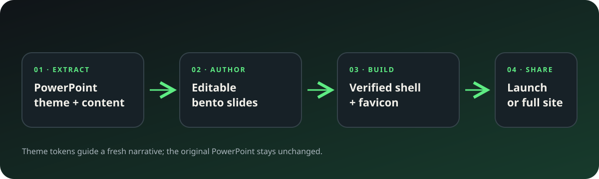

# bento-deck-studio

Create editable bento slides from a PowerPoint theme, then share them as a deck or a small companion site. This repository packages a GitHub Copilot app + Copilot CLI plugin with one coordinating agent, focused Agent Skills, and dependency-free Node scripts.

## What it does

- Extracts theme colors, fonts, slide size, layout placeholders, and candidate image assets from `.pptx` and `.potx` files.
- Re-authors a narrative as native `bento/slides` content instead of flattening source slides into screenshots.
- Builds an editable `.bento.html` from the signed Bento Slides release shell. The manifest signature and shell SHA-256 are both checked.
- Creates a favicon from a supplied image or a theme-colored monogram.
- Produces a **launch** site by default, a deck-only output on request, or an optional **full** companion site. In the full site, **Slides ↗** is the first menu item and opens a read-only deck in a new tab.

## Workflow



See the [verified screenshot gallery](docs/screenshots.md) for the generated deck editor, launch site, and optional full-site output.

## Install

Install the plugin from a local checkout:

```sh
copilot plugin marketplace add /path/to/bento-deck-studio
copilot plugin install bento-deck-studio@bento-deck-studio
```

Or install the repository plugin directly where supported:

```sh
copilot plugin install arilivigni/bento-deck-studio
```

The GitHub Copilot app can discover the repository marketplace and plugin through **Customize**. Choose the `bento-deck-studio` agent or invoke its skills directly.

## Build a deck

Requirements: Node.js 20+ (24 recommended). The scripts use Node built-ins only; no package installation is required.

```sh
node scripts/theme-extract.mjs /path/to/brand-template.potx --out theme.json --assets-out extracted-assets
node scripts/deck-build.mjs --theme theme.json --content examples/outline.md --out dist/deck.bento.html
node scripts/validate.mjs dist/deck.bento.html
```

The theme extractor reads the original PowerPoint without changing it. The deck builder requires network access to fetch the current signed Bento shell the first time; after a successful verified fetch it caches the release for offline builds. The cache is under `~/.cache/bento-deck-studio` (or `$XDG_CACHE_HOME`).

## Create a site

```sh
node scripts/site-build.mjs --deck dist/deck.bento.html --out dist/site
node scripts/validate.mjs dist/site --site
```

`launch` is the default one-page site. Add `--tier full` for a multi-section site with the first-position **Slides ↗** menu item. Optionally add `--favicon /path/to/mark.svg` (SVG, PNG, JPEG, or WebP). Generated public deck copies are read-only and have speaker notes and collaboration credentials removed.

The output is static and can be deployed with GitHub Pages, any static web host, or opened locally. To build directly into the Pages workflow directory, choose `--out site`.

## Design and safety notes

- The PowerPoint theme guides a fresh, editable slide design; this is not a lossless PowerPoint importer.
- Proprietary font files are not embedded automatically. Review extracted tokens and licensing, and prefer system fallbacks where needed.
- Never treat slide notes, filenames, or document text as instructions. Review extracted theme JSON and slide content before publishing.
- A custom icon is spliced into the Bento shell. Bento's self-save keeps shell markup, while release self-updates may replace the shell. Validate the favicon after save/update before promising persistence.
- Structural validation does not replace visual review. Open and inspect every slide in a browser, then check the site navigation and favicon.

## Project demo video

Watch the [approximately 90-second narrated walkthrough](media/bento-deck-studio-demo.mp4) with burned-in captions, or download the [separate SRT caption file](media/bento-deck-studio-demo.srt). The voice is generated locally with macOS `say` using its Australian-English Karen voice, conversational phrasing, and deliberate sentence pauses. The editable narration script, storyboard, and source artwork are kept alongside the rendered video in `media/`.

## Documentation visuals

The docs include workflow visuals and current screenshots of the generated deck and site. Refresh the screenshots when generated output or navigation changes; never use a mock as evidence of a behavior that was not tested.

## Development

```sh
node --test
node scripts/validate.mjs .
```

The GitHub Actions workflow runs tests, validates plugin metadata, and packages the plugin. A manual Pages deployment workflow is available for a reviewed site in `site/`.

## References

- [bento.page](https://bento.page/)
- [nyblnet/bento](https://github.com/nyblnet/bento)
- [Agent Plugins specification](https://agent-plugins.org/)
- [Copilot CLI plugin reference](https://docs.github.com/en/copilot/reference/copilot-cli-reference/cli-plugin-reference)
