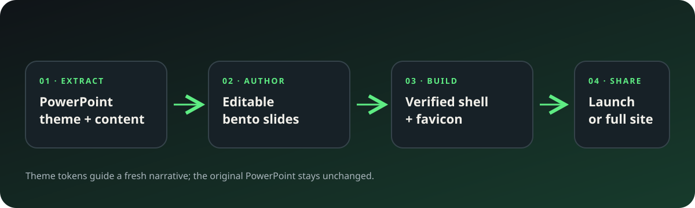
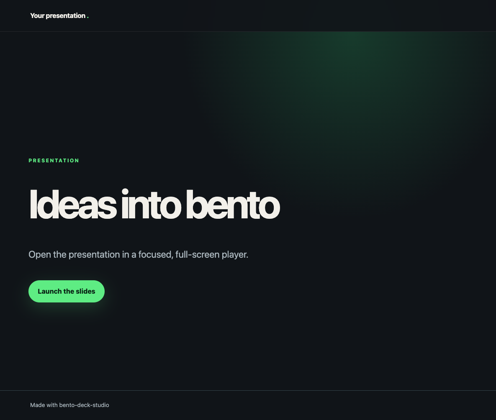
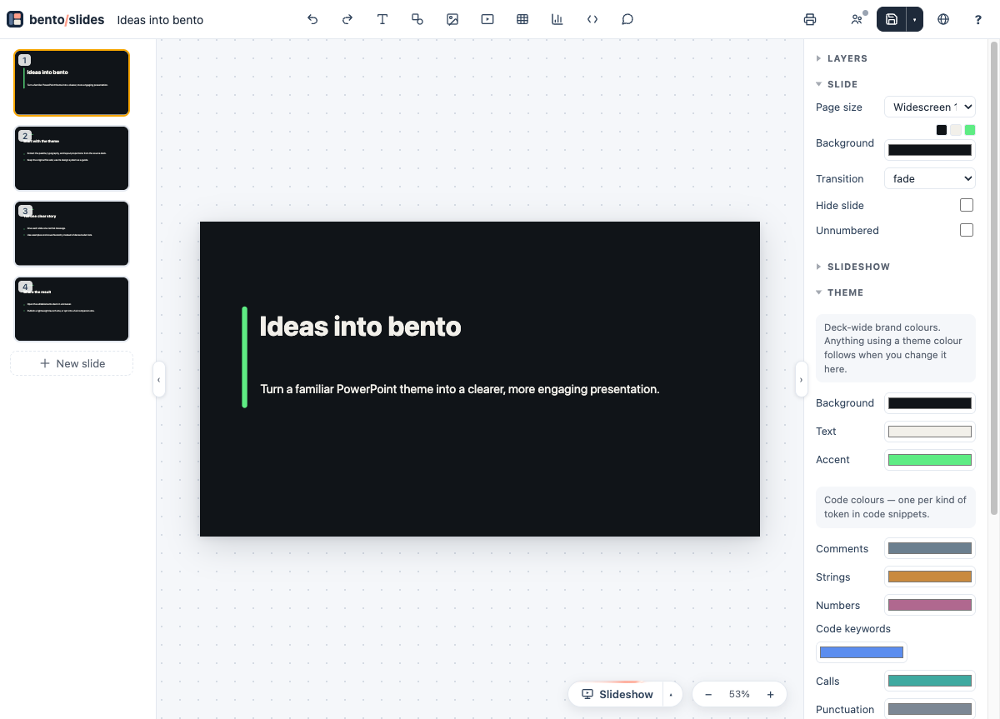
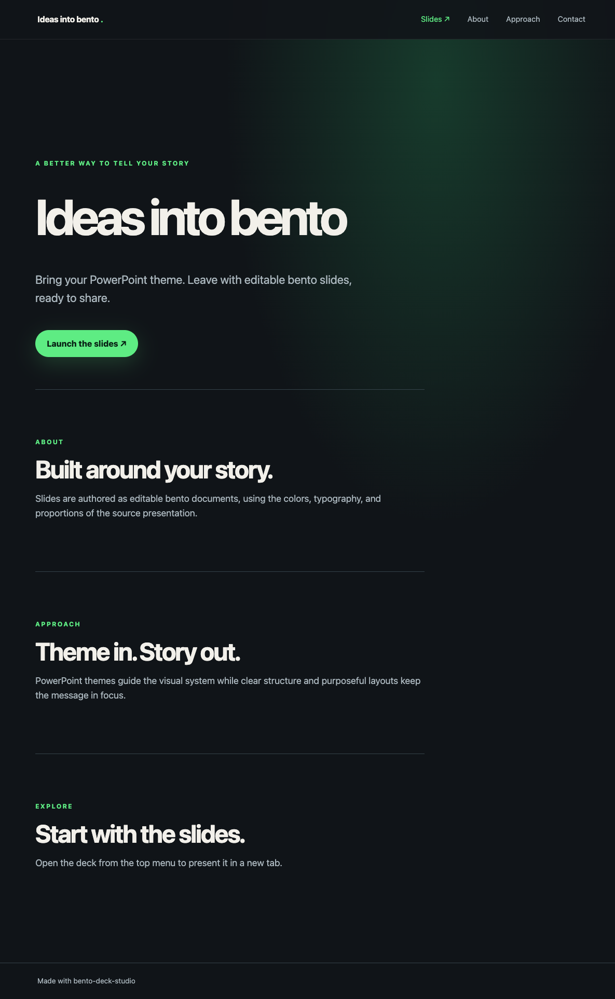

# Screenshots and workflow visuals

These are real browser captures of the repository's generated sample output, reviewed at presentation size. They are refreshed when the visible output or navigation changes.

## Narrated demo

The [approximately 90-second walkthrough](../media/bento-deck-studio-demo.mp4) includes burned-in captions and a separate [SRT caption file](../media/bento-deck-studio-demo.srt).

## Extract, author, and share

## Default launch site

The default site is a minimal, responsive launch page with a clear path to the presentation.

## Editable bento deck

The generated deck opens in the bento editor with editable elements and a slide navigator.

## Optional full companion site

The full-site option adds sections and puts **Slides ↗** first in the top navigation. It opens the read-only deck in a new tab.

